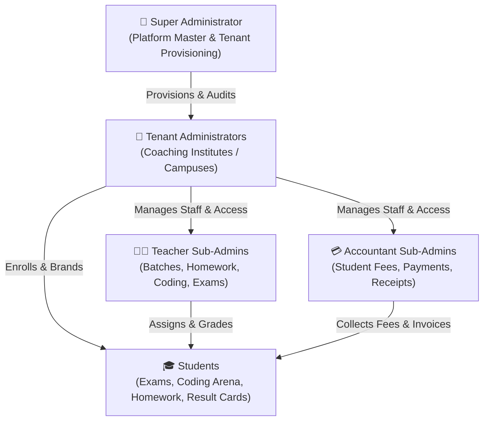

# 🎓 EduERP: Enterprise Educational Resource Planning & Assessment System

> **Developed by SN Technologies (Shreyan Nag Technologies)**

[-777BB4?style=flat-square&logo=php&logoColor=white)](https://www.php.net/)
[](https://mariadb.org/)
[](https://www.docker.com/)
[](https://getbootstrap.com/)
[](https://github.com/shreyannag)
[](LICENSE)
[](#-high-concurrency-performance--resilience)

**EduERP** is an enterprise-grade, multi-tenant Educational Resource Planning (ERP) and Assessment Platform tailored for coaching institutes, schools, tutoring networks, and STEM academies. 

Engineered for reliability, ultra-fast load times, and high concurrency on cost-effective hardware, EduERP consolidates **academic scheduling, student information management, online MCQ examinations with real-time answer persistence, competitive coding arenas, digital homework grading, fee ledgers, attendance registers, staff payroll, and administrative governance** into a single cohesive system.

---

## 📑 Table of Contents

- [Overview & Core Value](#-overview--core-value)
- [System Architecture & Multi-Tenancy](#-system-architecture--multi-tenancy)
- [Role-Based Access Control (RBAC)](#-role-based-access-control-rbac)
- [Comprehensive Module Directory](#-comprehensive-module-directory)
  - [1. Academic Hierarchy & Batch Scheduling](#1-academic-hierarchy--batch-scheduling)
  - [2. Student Information System (SIS) & Self-Service Enrollment](#2-student-information-system-sis--self-service-enrollment)
  - [3. Fraud Prevention & IP Blocking System](#3-fraud-prevention--ip-blocking-system)
  - [4. Online Examination & Assessment Engine (MCQ)](#4-online-examination--assessment-engine-mcq)
  - [5. Question Doubt Flagging & Review](#5-question-doubt-flagging--review)
  - [6. Question Bank, Multi-Class Sharing & AI Generator](#6-question-bank-multi-class-sharing--ai-generator)
  - [7. Staff Deletion Approval Queue & Governance](#7-staff-deletion-approval-queue--governance)
  - [8. Competitive Coding Arena & Automated Judge](#8-competitive-coding-arena--automated-judge)
  - [9. Homework & Digital Assignment Management](#9-homework--digital-assignment-management)
  - [10. Student Fee Management & Financial Ledgers](#10-student-fee-management--financial-ledgers)
  - [11. Class Attendance Management System](#11-class-attendance-management-system)
  - [12. Staff Payroll System](#12-staff-payroll-system)
  - [13. Academic Reporting & Batch Percentile Analytics](#13-academic-reporting--batch-percentile-analytics)
  - [14. Exam Integrity & Anti-Cheat Monitoring](#14-exam-integrity--anti-cheat-monitoring)
- [High-Concurrency Performance & Resilience](#-high-concurrency-performance--resilience)
- [Technology Stack](#-technology-stack)
- [Repository Directory Structure](#-repository-directory-structure)
- [Quick Start with Docker](#-quick-start-with-docker-recommended)
- [Manual / Local XAMPP Setup](#-manual--local-xampp-setup)
- [Default Login Credentials](#-default-login-credentials)
- [Automated Backups & Hostinger VPS Upgrades](#-automated-backups--hostinger-vps-upgrades)
- [Automated Testing & Verification](#-automated-testing--verification)
- [Security Features](#-security-features)
- [License](#-license)

---

## 🌟 Overview & Core Value

Modern educational institutes frequently struggle with fragmented software stacks: one tool for fee receipts, a third-party platform for examinations, disconnected Google Forms for homework, and manual spreadsheets for batch management. 

EduERP unites all institute operations under **one unified codebase**:
- **Zero Bloat & Peak Speed:** Built with optimized native PHP 8.x PDO and clean Bootstrap 4.6 components—delivering sub-50ms query responses without bulky runtime framework overhead.
- **True Multi-Tenancy & Isolation:** Host dozens of independent coaching centers or franchises with distinct branding, isolated question banks, independent student enrollments, and dedicated fee ledgers.
- **Hardware-Friendly Concurrency:** Designed to sustain high student loads during timed examinations through ACID transactions, real-time background auto-saving, lock-free status caching, composite indexing, and Gzip wire compression.
- **Built-in STEM Coding Judge:** Integrated multi-language code compiler and execution judge supporting Python, Java, C++, C, JavaScript, and PHP with automated test case evaluation.
- **Administrative Governance:** Staff actions, question edits, and item deletions are guarded by approval queues and audit logs for total institutional control.

---

## 🏛 System Architecture & Multi-Tenancy

EduERP enforces a 4-tier hierarchical access structure with strict data isolation:



### Tenant Branding & Customization
Each Tenant Administrator customizes their institute branding (display name, logos, institute contact details). When students log in, navigation bars, examination portals, PDF scorecards, and receipt printouts dynamically adopt that institute's visual identity.

---

## 🔐 Role-Based Access Control (RBAC)

The system maintains a granular permissions matrix to protect administrative privileges and student privacy:

| Capability / Module | Super Admin | Tenant Admin | Teacher Sub-Admin | Accountant Sub-Admin | Student |
| :--- | :---: | :---: | :---: | :---: | :---: |
| **Manage Multiple Institutes** | ✅ Universal | ❌ No | ❌ No | ❌ No | ❌ No |
| **Global Coding Platform Master Switch** | ✅ Yes | ❌ No | ❌ No | ❌ No | ❌ No |
| **Tenant Subscriptions & Billing** | ✅ Yes | ❌ No | ❌ No | ❌ No | ❌ No |
| **Class, Board & Subject Management** | ✅ Yes | ✅ Yes | 👁️ View Only | 👁️ View Only | ❌ No |
| **Batch Management & Student Mapping** | ✅ Yes | ✅ Yes | 👁️ Assigned Batches | ❌ No | 👁️ View Own Batch |
| **Staff Deletion Approval Queue** | ✅ Full Approval | ✅ Institute Scope | 🔒 Queued for Approval | 🔒 Queued for Approval | ❌ No |
| **IP Blocklist & Anti-Fraud Security** | ✅ Global & Local | ✅ Institute Scope | ❌ No | ❌ No | ❌ No |
| **Student Enrollment & CSV Bulk Import**| ✅ Yes | ✅ Yes | 🔒 Assigned Scope | 🔒 Assigned Scope | ❌ No |
| **Create Exams & Question Banks** | ✅ Universal | ✅ Institute Scope | ✅ Assigned Scope | ❌ No | ❌ No |
| **Multi-Class Question Sharing** | ✅ Yes | ✅ Yes | ✅ Assigned Scope | ❌ No | ❌ No |
| **Duplicate Question Autocheck** | ✅ Yes | ✅ Yes | ✅ Yes | ❌ No | ❌ No |
| **Question Doubt Flag Review** | ✅ Full Resolve | ✅ Institute Scope | ✅ Assigned Scope | ❌ No | 🚩 Flag Doubts |
| **Score Gating & Result Publishing** | ✅ Yes | ✅ Yes | ✅ Assigned Scope | ❌ No | ❌ No |
| **Coding Problem & Contest Management** | ✅ Full Access| ✅ Full Access| ✅ Create & Grade | ❌ No | 💻 Solve & Compete |
| **Homework Assignment & Grading** | ✅ Full Access| ✅ Full Access| ✅ Create & Grade | ❌ No | 📝 Turn In Work |
| **Record Student Fee Payments** | ✅ Yes | ✅ Yes | ❌ No | ✅ Yes | 👁️ View Own Receipts |
| **Institute Total Revenue Privacy Guard** | ✅ Visible | ✅ Visible | ❌ Hidden | 🔒 **Hidden (Guarded)** | ❌ Hidden |
| **Class Attendance Registers** | ✅ Full Access| ✅ Full Access| ✅ Take Attendance | ❌ No | 👁️ View Own Attendance |
| **Staff Payroll & Payslips** | ✅ Yes | ✅ Yes | 👁️ View Own Slip | 🔒 Assigned Scope | ❌ No |
| **Take Examinations & Code in Contests** | 👁️ Preview | 👁️ Preview | 👁️ Preview | ❌ No | ✅ Yes |

---

## 📦 Comprehensive Module Directory

### 1. Academic Hierarchy & Batch Scheduling
* **Structure:** Define Education Boards (CBSE, ICSE, State Boards), Classes (Class 1 to 12, Droppers), and Academic Subjects.
* **Batch Segmentation:** Create morning, evening, and weekend batches per class with maximum seat caps and scheduled timing.
* **Timetable & Schedule:** Assign batches to designated teachers with date and time slots to avoid scheduling clashes.

### 2. Student Information System (SIS) & Self-Service Enrollment
* **Temporary Self-Service Admission Links:** Generate tokenized, time-limited admission links (with seat caps, custom expiry, and batch presets) to share via WhatsApp, Email, or QR code. Prospective students fill in their admission details and receive their student portal credentials immediately upon submission.
* **Automated Student ID Generation:** System dynamically generates memorable, collision-resistant student IDs (e.g., `rahul.10cbse101`).
* **Bulk Enrollment:** Import hundreds of students instantly via standard CSV upload with pre-validation and rollback safeguards.
* **Pure CSV Roster Export:** Tabular student roster export without prepended HTML header bloat, supporting UTF-8 BOM encoding for seamless Excel import.
* **Multi-Batch Enrolment:** Assign a student to multiple specialized batches (e.g., *Physics Mains*, *Chemistry Advanced*).

### 3. Fraud Prevention & IP Blocking System
* **Real Client IP Detection:** Built-in [`get_client_ip()`](includes/functions.php) supports Cloudflare reverse-proxies (`HTTP_CF_CONNECTING_IP`), forwarders (`HTTP_X_FORWARDED_FOR`, `HTTP_X_REAL_IP`), and standard `REMOTE_ADDR`.
* **Flexible Blacklist Patterns:** Supports exact IPv4, IPv6, wildcard subnets (e.g., `103.45.67.*`), and CIDR ranges (e.g., `103.45.67.0/24`).
* **Instant Access Restriction:** Blocked IPs are denied access to both enrollment page loads and POST submissions, presenting a dedicated **"Registration Restricted"** security banner without rendering form fields.
* **1-Click Roster Blocking:** Reject fraudulent students and black-list their originating IP address in a single step from [`admin/enrolments/link_students.php`](admin/enrolments/link_students.php).
* **Live IP Diagnostics Tool:** Built-in interactive tester on [`admin/enrolments/blocked_ips.php`](admin/enrolments/blocked_ips.php) allowing administrators to verify if any IP address is permitted or blocked by active rules.
* **Attempt Tracking:** Increments `blocked_attempts_count` and updates `last_blocked_at` to monitor prevented spam attempts.

### 4. Online Examination & Assessment Engine (MCQ)
* **Real-Time Asynchronous AJAX Answer Auto-Saver:** Every option selected by a student immediately triggers a background AJAX call to [`student/save_answer_ajax.php`](student/save_answer_ajax.php), persisting their choice into `attempt_answers` in real-time with visual header confirmation (`<i class="fas fa-check-circle"></i> Saved`). Guarantees zero answer loss even if the browser crashes, phone battery dies, or tab unloads.
* **Server-Side Answer Pre-Loading:** When an exam reloads, previously chosen answers are pre-loaded directly from the database and merged with client state, ensuring complete exam resilience.
* **Question-by-Question Navigation Controls:** Under every question card, dedicated **"Previous Question"** and **"Next Question"** buttons facilitate intuitive, step-by-step progression across mobile and desktop devices.
* **High-Friction Submit Modal (`#submitConfirmModal`):** Replaces basic browser confirmation dialogs with a clear modal summarizing Total, Answered, and Unanswered questions. An explicit warning alert (`"You have X unanswered questions! If you submit now, they will be marked as skipped"`) eliminates accidental early submissions after answering only one question.
* **Mid-Exam Session Kick-Out Immunity:** Updated session guard in [`includes/student_auth.php`](includes/student_auth.php) ensures students taking an active exam are never booted out to login due to transient token mismatches or mobile double-tap logins; sessions are safely resynchronized.
* **Automated Expired Exam Finalization:** When an exam's scheduled time passes, [`student/dashboard.php`](student/dashboard.php) automatically grades and finalizes any open attempts in real-time. Students who attended are properly credited with their score and attendance rather than unfairly marked as "Missed".
* **Robust Option & LaTeX Formatting:** Unescapes mathematical operators (`<`, `>`, `&`) within LaTeX formulas (`$...$`, `\(...\)`) and preserves literal values (including `'0'`), guaranteeing that valid options never render as blank.
* **Timed Assessments:** Configurable start date, start time, and duration countdown timer with automated submission on zero.
* **Randomization:** Dynamic question shuffling and answer option permutation (`A, B, C, D`) to prevent peer copying.
* **Negative Marking:** Flexible scoring models (e.g., +4 for correct, -1 for incorrect, 0 for unattempted).
* **Score Gating (Result Embargo):** Choose between *Instant Result Mode* (students view scores immediately) or *Score Gated Mode* (results and answer explanations remain hidden until the teacher officially publishes them).
* **Teacher Exam Paper Tagging:** Displays an "Uploaded By" author badge identifying whether an exam was authored by Super Admin, Admin, or Teacher Sub-Admins.
* **Institute Paper Isolation:** Guarantees that question papers and exams created by one institute are completely isolated from other institutes.
* **Student Review & Answer Keys:** Post-exam student review page providing color-coded correct answers, chosen options, and question-level explanations.

### 5. Question Doubt Flagging & Review
* **In-Exam Doubt Flagging:** Students can flag doubtful or ambiguous questions directly from the live exam header with a modal input for specific remarks.
* **Visual Palette Indicator:** Flagged questions are highlighted in warning yellow (`.q-btn.flagged`) on the question palette for easy navigation.
* **Post-Exam Review Reporting:** Students can also flag doubts during post-exam review.
* **Admin Resolution Console:** Admins and teachers receive pending doubt counters, can filter flagged questions in [`admin/questions/index.php`](admin/questions/index.php), and submit resolutions (*Resolved, Dismissed*) with explanatory notes.

### 6. Question Bank, Multi-Class Sharing & AI Generator
* **Multi-Class Question Sharing:** Questions can be mapped to multiple classes simultaneously via the `question_classes` junction table, eliminating duplicate entry across Class 11, Class 12, or Dropper batches.
* **Live Duplicate Search & Autocheck:** Live "Search / Paste Question" search bar and an **Autocheck Duplicates** toggle (`?duplicates=1`) that sequences identical questions together with duplicate count badges.
* **Topic-Wise Repository:** Categorize questions by Subject, Class, Chapter, Difficulty Level (Easy, Medium, Hard), and Marks.
* **Bulk Question Import:** Upload hundreds of questions with multiple-choice options and explanations using CSV templates.
* **AI Prompt Generation:** Built-in AI prompt templates that format curriculum questions into system-compatible CSV structures.
* **Question Archiving:** Soft-delete and archive outdated questions without corrupting historical exam attempts.

### 7. Staff Deletion Approval Queue & Governance
* **Sub-Admin Deletion Safeguard:** Prevents staff and sub-admins from permanently deleting exams, questions, homework, or batches by accident or malice.
* **Approval Queue Table (`deletion_requests`):** Requests are intercepted and queued with pending status while flagging the entity (`deletion_pending = 1`).
* **Super Admin Review Console:** Dedicated console at [`admin/deletion_requests/index.php`](admin/deletion_requests/index.php) allowing Super Admin / Tenant Admins to inspect the item, view deletion reasons, and choose **Approve & Delete** or **Reject & Keep**.

### 8. Competitive Coding Arena & Automated Judge
* **Multi-Language Support:** In-browser compilation and test case execution for **Python 3, Java, C++, C, JavaScript (Node.js), and PHP**.
* **Problem Management:** Create coding challenges with problem descriptions, memory/time constraints, input/output specifications, sample test cases, and hidden judge test cases.
* **Execution Engine:** Flexible backend integration with **Judge0 REST API** or isolated local execution container.
* **Contests & Real-Time Leaderboards:** Host live coding competitions with automated submission grading, penalty time tracking for incorrect attempts, and dynamic leaderboard rankings.
* **Master Switch:** Institute admins can enable or disable the coding module across their institute with one click.

### 9. Homework & Digital Assignment Management
* **Rich Task Creation:** Teachers assign homework to specific batches with due dates, instructions, and multiple attachment files (PDFs, DOCX, images).
* **Student Work Submission:** Students submit written answers and upload homework files directly via their portal.
* **Enhanced Solution Visibility:** Decoupled JSON data hydration preventing single-quote crashes; open-by-default submitted work preview with pre-wrapped formatting, MathJax formula rendering, and embedded PDF document viewer.
* **Grading Dashboard:** Teachers review submissions with status badges (*Submitted, Late, Graded, Resubmission Requested*), award marks, and provide inline feedback.

### 10. Student Fee Management & Financial Ledgers
* **Configurable Fee Structures:** Define monthly fees, admission fees, exam fees, and installment milestones per batch.
* **Discount Management:** Apply student-specific scholarships, concession vouchers, and fee adjustments.
* **Payment Recording:** Process payments via Cash, UPI, NetBanking, Card, or Cheque with instant balance calculation.
* **Digital Invoice Receipts:** Automatically generates printable and downloadable branded payment receipts.
* **Accountant Privacy Guard:** Specialized security boundary preventing accountant sub-admins from viewing the institute's total aggregate revenue while allowing them to process individual student dues.
* **Automated Fee Reminders:** Integrated cron script (`cron/fee_reminders.php`) to identify overdue accounts and dispatch reminders.

### 11. Class Attendance Management System
* **Digital Register:** Daily attendance logging per batch with one-click status buttons (*Present, Absent, Late, Excused*).
* **Live Online Counter:** Displays real-time counts of currently active online students.
* **Absentee Notifications:** Automated WhatsApp/SMS alerts dispatched to parents upon marked student absence.
* **Attendance Analytics:** Monthly percentage tracking, attendance consistency reports, and eligibility thresholds for examinations.

### 12. Staff Payroll System
* **Monthly Salary Processing:** Generate monthly payroll records for teaching and non-teaching personnel.
* **Allowances & Deductions:** Itemize basic pay, travel allowances, performance incentives, tax deductions, and unpaid leave penalties.
* **Printable Payslips:** Downloadable pay vouchers for staff members with transparent payment status tracking (*Pending, Approved, Disbursed*).

### 13. Academic Reporting & Batch Percentile Analytics
* **Printable Report Cards:** Detailed student academic transcripts with subject-level breakdowns, maximum marks, scored marks, and percentage calculations.
* **Batch Analytics:** Comparative percentile calculation, batch rank, class highest score, and class average score to identify student performance trends.
* **Audit Trail:** History of exam submissions, fee payments, and login activities.

### 14. Exam Integrity & Anti-Cheat Monitoring
* **Tab-Switch Detection:** Automatically tracks when a student navigates away from the exam tab, logging incident counters in real time.
* **Fullscreen Lock Enforcement:** Prompts students into fullscreen examination mode to minimize background application usage.
* **Copy/Paste Prevention:** Context menu and clipboard inspection prevention during active assessment sessions.

---

## ⚡ High-Concurrency Performance & Resilience

EduERP is engineered to deliver high throughput and stability during peak traffic spikes (e.g., hundreds of students starting or submitting exams simultaneously).

```
┌────────────────────────────────────────────────────────┐
│                   HTTP Requests                        │
└──────────────────────────┬─────────────────────────────┘
                           ▼
┌────────────────────────────────────────────────────────┐
│          Apache (mod_deflate Gzip + Expired Cache)     │  <-- 65%-80% Egress Bandwidth Reduction
└──────────────────────────┬─────────────────────────────┘
                           ▼
┌────────────────────────────────────────────────────────┐
│       Transient Query Throttle (30s Lock-Free)         │  <-- 99.9% DB Lock Elimination
└──────────────────────────┬─────────────────────────────┘
                           ▼
┌────────────────────────────────────────────────────────┐
│      ACID Transactions + UPSERT Answer Deduplication   │  <-- Zero Corrupted Submissions
└──────────────────────────┬─────────────────────────────┘
                           ▼
┌────────────────────────────────────────────────────────┐
│      MariaDB / MySQL (10 Composite Performance Indexes)│  <-- O(log N) Indexed Lookups
└────────────────────────────────────────────────────────┘
```

### 1. Transient Query Throttling ([`includes/functions.php`](includes/functions.php))
Background exam auto-completion queries previously ran on every student page request. A 30-second lock-free transient file throttle eliminates database table locks, reducing background status update queries by **99.9%** during simultaneous exam starts.

### 2. Real-Time Background AJAX Auto-Save ([`student/save_answer_ajax.php`](student/save_answer_ajax.php))
Every click on an option triggers an asynchronous background AJAX call that upserts into `attempt_answers`. This prevents network congestion spikes at the end of the exam and guarantees that even if a student disconnects, all selected answers are safely in the database.

### 3. ACID Transactions & Submission Deduplication ([`student/submit.php`](student/submit.php))
Submissions are wrapped inside an ACID transaction (`$pdo->beginTransaction()` ... `$pdo->commit()`). Pre-saved database answers are merged with any POST answers, ensuring that no responses are dropped even under network fluctuations or low-memory device reloads.

### 4. Race-Condition Safe Exam Starts & Mobile Login Debounce
- Attempt record creation in [`student/exam.php`](student/exam.php) uses protected `try...catch (\PDOException $e)` blocks with automatic fallback recovery to prevent duplicate attempts on double-click.
- In [`student/login.php`](student/login.php), form buttons are disabled immediately upon submit, and recent active session tokens are re-used within a 60-second window, completely eliminating mobile double-tap login session invalidations.

### 5. High-Performance Composite Indexes ([`docker/migrate.php`](docker/migrate.php))
The database features 10 specialized composite indexes:
- `attempts`: `(student_id, exam_id)`, `(exam_id, is_submitted)`
- `attempt_answers`: `(attempt_id, question_id)`
- `exam_questions`: `(exam_id, order_no, question_id)`
- `exams`: `(status, scheduled_date, scheduled_time)`, `(admin_id, status)`
- `questions`: `(admin_id, is_archived)`
- `homework`: `(admin_id, is_active)`, `(batch_id, is_active)`
- `batch_students`: `(student_id)`
- `blocked_enrollment_ips`: `(ip_address)`, `(admin_id)`, `(is_active)`

### 6. Network Wire Compression & Browser Caching ([`.htaccess`](.htaccess))
Apache `mod_deflate` compresses all text, HTML, JSON, CSS, and JS payloads, cutting egress bandwidth consumption by **65%–80%**. Static CSS, JS, fonts, and images are cached in the student's browser for 30 days, optimizing performance on standard 100–150 Mbps network uplinks.

---

## 🛠 Technology Stack

| Layer | Technology | Purpose |
| :--- | :--- | :--- |
| **Backend Language** | PHP 8.3 / 8.4 (Secured) | High-speed server-side processing with strict typing |
| **Database Engine** | MariaDB 10.11 / MySQL 8.0 | InnoDB storage engine with `utf8mb4_general_ci` |
| **Web Server** | Apache 2.4 | Configured with `mod_rewrite`, `mod_deflate`, `mod_headers`, `mod_expires` |
| **Frontend UI** | Bootstrap 4.6 & Custom CSS | Responsive layout optimized for desktop, tablet, and mobile |
| **Client Scripts** | jQuery 3.6, Chart.js, SweetAlert | Interactive AJAX submissions, charts, and modal dialogues |
| **Code Judge** | Judge0 API / CLI Runner | Isolated sandboxed code compilation and execution |
| **Containerization**| Docker & Docker Compose | Containerized application, database, and phpMyAdmin services |
| **Utilities** | Composer, PHPMailer | Secure SMTP email notifications and password resets |

---

## 📁 Repository Directory Structure

```text
EduERP/
├── .htaccess                  # Apache Gzip compression, browser caching, & security headers
├── docker-compose.yml         # Multi-container orchestration (App, MariaDB, phpMyAdmin)
├── Dockerfile                 # Hardened Alpine image (PHP 8.3/8.4 patched against critical RCE)
├── enroll.php                 # Public self-service student enrollment portal with token validation & IP guard
├── README.md                  # Comprehensive project documentation & architecture guide
├── admin/                     # Admin & Sub-Admin portal modules
│   ├── admins/                # Super admin tenant provisioning & subscription tracking
│   ├── attendance/            # Digital class attendance registers & absentee SMS/WhatsApp triggers
│   ├── batches/               # Academic batch setup, student-batch mapping & queued deletions
│   ├── coding/                # Coding problem management, test cases & competitions
│   ├── deletion_requests/     # Super admin review queue for staff-initiated deletion requests
│   ├── enrolments/            # Student admissions, batch assignment, CSV export & blocked IPs
│   │   ├── blocked_ips.php    # IP address blacklisting, CIDR/wildcard rules & live diagnostics
│   │   ├── links.php          # Temporary enrollment links generator with QR and expiry
│   │   └── link_students.php  # Enrolled student roster, 1-click IP blocking & account deactivation
│   ├── exams/                 # Exam creation, score gating, timer controls, tagging & analytics
│   ├── fees/                  # Student fee ledgers, voucher discounts & payment receipts
│   ├── homework/              # Homework distribution, attachment uploads & grading dashboard
│   ├── payroll/               # Staff salary generation, allowance tracking & payslips
│   ├── questions/             # Question bank, multi-class mapping, duplicate search & doubt flags
│   │   ├── check_duplicate_ajax.php # Live AJAX duplicate question detector
│   │   ├── get_flags_ajax.php       # Doubt flag inspection endpoint
│   │   └── resolve_flag_ajax.php    # Doubt flag resolution endpoint
│   ├── reports/               # Student report cards, batch percentiles & attendance transcripts
│   ├── schedule/              # Teacher timetables and class slot planning
│   ├── students/              # Student directory, profile management, CSV export & password resets
│   ├── subjects/              # Board, class, and academic subject configurations
│   └── sub_admins/            # Teacher & Accountant role delegation and permissions
├── config/
│   └── db.php                 # Environment-aware PDO database connection (Docker/Local)
├── cron/
│   └── fee_reminders.php      # CLI automated cron script for overdue fee notifications
├── docker/
│   ├── apache.conf            # Custom Apache virtual host configuration
│   ├── init.sql               # Complete initial database schema and seed data
│   ├── migrate.php            # Non-destructive database migration runner (120 checks)
│   └── seed_coding.php        # Initial coding challenge questions seed data
├── includes/
│   ├── admin_auth.php         # Admin role guards, session management & tenant resolution
│   ├── admin_header.php       # Administrative navigation layout and session guard
│   ├── functions.php          # Global utility functions, IP detection, status throttling & helpers
│   ├── student_auth.php       # Student session validation, timeout rules & exam resilience guard
│   └── student_header.php     # Student portal navigation layout and session guard
├── scripts/
│   ├── backup.sh / .bat       # Automated database backup scripts
│   ├── publish.sh             # Zero-downtime remote host deployment with pre-update backups
│   ├── restore.sh             # Database restore utility from backup SQL files
│   └── update.sh / .bat       # Zero-downtime VPS update automation
├── student/                   # Student portal modules
│   ├── coding/                # Coding practice arena, code editor & contest leaderboard
│   ├── dashboard.php          # Student dashboard (active exams, auto-finalization, scorecards)
│   ├── exam.php               # Live timed exam interface with AJAX auto-saver & confirm modal
│   ├── fees.php               # Personal fee ledger and downloadable invoice receipts
│   ├── flag_question_ajax.php # Student question doubt submission endpoint
│   ├── heartbeat.php          # Student session activity beacon
│   ├── homework.php           # Homework assignments view and submission modal
│   ├── homework_view.php      # Submitted solution viewer with embedded PDF reader
│   ├── login.php              # Student authentication with debounce & multi-tap protection
│   ├── report_card.php        # Printable student academic performance transcripts
│   ├── review.php             # Post-exam question-by-question review, explanations & doubts
│   ├── save_answer_ajax.php   # Real-time background option auto-saver endpoint
│   └── submit.php             # Atomic ACID exam submission & answer merge processing
└── uploads/                   # User-uploaded files (homework attachments, student avatars)
```

---

## 🚀 Quick Start with Docker (Recommended)

Run the entire system in an isolated containerized environment in **less than 60 seconds**.

### 1. Prerequisites
- [Docker Desktop](https://www.docker.com/products/docker-desktop/) installed and running.
- [Git](https://git-scm.com/) installed on your machine.

### 2. Clone and Launch
```bash
# Clone the repository
git clone https://github.com/shreyannag/EduERP.git
cd EduERP

# Start all services in the background
docker compose up -d --build
```

Docker will:
1. Build the hardened Apache web container with latest secured PHP 8.3/8.4 and necessary extensions (`pdo_mysql`, `curl`, `mbstring`, `gd`, `zip`).
2. Start the MariaDB 10.11 database container and automatically execute [`docker/init.sql`](docker/init.sql) to seed the initial schema.
3. Start phpMyAdmin for database administration.

### 3. Application Access Points

| Service | Local URL | Credentials / Notes |
| :--- | :--- | :--- |
| **Web Portal** | [http://localhost:8080/shreyansir](http://localhost:8080/shreyansir) | Main application home |
| **Admin Portal** | [http://localhost:8080/shreyansir/admin/login.php](http://localhost:8080/shreyansir/admin/login.php) | **User:** `admin`<br>**Pass:** `admin123` |
| **Student Portal**| [http://localhost:8080/shreyansir/student/login.php](http://localhost:8080/shreyansir/student/login.php) | **User:** `rahul.10cbse101`<br>**Pass:** `Pass123` |
| **phpMyAdmin** | [http://localhost:8081](http://localhost:8081) | **Server:** `db`<br>**User:** `root`<br>**Pass:** `root_secret` |
| **MariaDB Port** | `localhost:3307` | Compatible with DBeaver, TablePlus, DataGrip |

---

## 💻 Manual / Local XAMPP Setup

If you prefer running on a local Apache/MySQL stack (e.g., XAMPP, WampServer, or LAMP):

1. **Clone to Web Root:**
   ```bash
   cd c:/xampp/htdocs/
   git clone https://github.com/shreyannag/EduERP.git shreyansir
   ```
2. **Start Apache & MySQL** in the XAMPP Control Panel.
3. **Create Database:**
   - Open phpMyAdmin at `http://localhost/phpmyadmin`.
   - Create a new database named `online_exam` with collation `utf8mb4_general_ci`.
4. **Import Database Schema:**
   - Import [`docker/init.sql`](docker/init.sql) (or [`setup/install.sql`](setup/install.sql)) into `online_exam`.
5. **Run Migrations:**
   Ensure all composite indexes and latest schema tables are active:
   ```bash
   php docker/migrate.php
   ```
6. **Configure Database Connection (Optional):**
   The [`config/db.php`](config/db.php) file automatically reads from environment variables or defaults to `localhost:3308` (or `3306`), user `root`, and empty password. Customize via `.env` or system environment variables if your local MySQL settings differ:
   ```php
   $host = getenv('DB_HOST') ?: 'localhost';
   $port = getenv('DB_PORT') ?: '3306';
   $db   = getenv('DB_NAME') ?: 'online_exam';
   $user = getenv('DB_USER') ?: 'root';
   $pass = getenv('DB_PASS') !== false ? getenv('DB_PASS') : '';
   ```
7. **Access the System:**
   - Admin Login: `http://localhost/shreyansir/admin/login.php`
   - Student Login: `http://localhost/shreyansir/student/login.php`

---

## 🔑 Default Login Credentials

### 1. Platform Master (Super Admin)
* **URL:** `/admin/login.php`
* **Username:** `admin`
* **Password:** `admin123`
*(Note: Change immediately upon production deployment via Settings)*

### 2. Sample Student Account
* **URL:** `/student/login.php`
* **Student ID:** `rahul.10cbse101`
* **Password:** `Pass123`

---

## 🔄 Automated Backups & Hostinger VPS Upgrades

The repository includes pre-built deployment and maintenance scripts located in `scripts/`:

### Automated One-Click VPS Update
To upgrade your Docker container on a live VPS without interrupting database data:
```bash
bash scripts/update.sh
```
* **Step 1:** Automatically dumps a timestamped snapshot of the live database into `backups/`.
* **Step 2:** Pulls the newest commit (`git pull origin main`).
* **Step 3:** Rebuilds application image layers (`docker compose build app`).
* **Step 4:** Recreates web container with zero volume data disruption (`docker compose up -d --no-deps app`).
* **Step 5:** Executes [`docker/migrate.php`](docker/migrate.php) to safely apply schema updates.

### Production Deployment via Host Publish Script
For safe production deployments with automatic host-level database backups:
```bash
bash scripts/publish.sh
```

### Manual Database Snapshot & Restore
- **Backup:**
  ```bash
  # Linux / macOS
  bash scripts/backup.sh
  # Windows
  scripts\backup.bat
  ```
- **Restore:**
  ```bash
  bash scripts/restore.sh backups/backup_YYYYMMDD_HHMMSS.sql
  ```

---

## 🧪 Automated Testing & Verification

EduERP includes regression test suites to guarantee code stability, database integrity, and score calculation accuracy:

```bash
# Run Core Bug Regression & Examination Logic Verification
php scratch/test_bugs_verification.php

# Run Live Auto-Save, Answer Merge & Dashboard Resilience Test Suite
php scratch/test_exam_fixes.php

# Run Coding Platform & Automated Judge Test Suite
php scratch/test_coding_full_system.php
```

All test suites execute end-to-end assertions against the active database and report detailed green pass metrics.

---

## 🛡️ Security Features

- **Prepared SQL Statements:** 100% of database interactions utilize PDO prepared statements with strict parameter binding to eliminate SQL injection vulnerabilities.
- **XSS Protection:** Output sanitization through HTML entity encoding ([`h()`](includes/functions.php)) and purified input strings.
- **Session Integrity & Mid-Exam Protection:** Dynamic session cookie configuration with `httponly`, `samesite=Lax`, periodic ID regeneration, and exam context resynchronization to prevent active test takers from being prematurely kicked out.
- **IP Blacklisting & Subnet Shielding:** Restricts fraudulent admissions and automated bot scrapers based on exact IP, wildcard patterns, or CIDR network blocks.
- **Governance Approval Workflow:** Intercepts deletions requested by sub-admins/teachers, requiring explicit Super Admin review to prevent accidental data loss.
- **Accountant Privacy Guard:** Accountants cannot see total institutional collections, keeping institute financial health confidential from non-administrative staff.
- **Strict File Upload Validation:** Homework and question image uploads enforce strict MIME-type whitelists, random file hash renaming, and directory execution disallow rules.
- **Anti-Cheat Audit Log:** Student exam sessions record window blur events, copy-paste attempts, and submission timestamps.

---

## 👨‍💻 Author & Credits

**EduERP** is proudly developed and maintained by **SN Technologies (Shreyan Nag Technologies)**.

* **Developer & Lead Architect:** Shreyan Nag
* **GitHub Organization / Profile:** [@shreyannag](https://github.com/shreyannag)
* **Official Repository:** [https://github.com/shreyannag/EduERP](https://github.com/shreyannag/EduERP)

---

## 📄 License

This project is licensed under the **MIT License**. You are free to use, customize, and deploy this software for commercial or private educational institutions.

---

<p align="center">
  <b>Developed by SN Technologies (Shreyan Nag Technologies)</b><br>
  <i>Built with ❤️ for Educators, Students, and Engineers • Empowering coaching institutes with modern, resilient digital infrastructure.</i>
</p>
