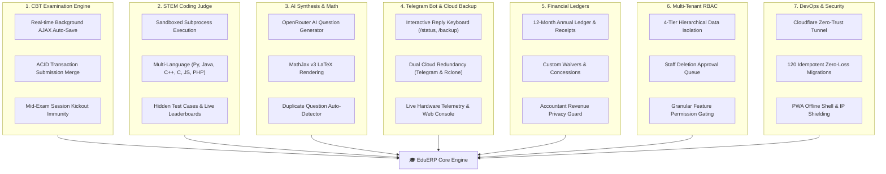
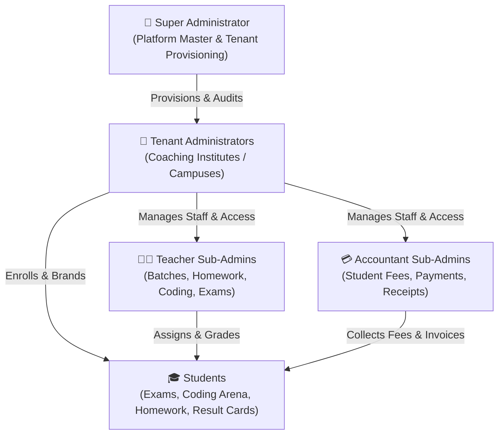

# 🎓 EduERP: Enterprise Educational Resource Planning & Assessment Platform

<p align="center">
  <b>Enterprise-grade, high-concurrency Multi-Tenant Educational ERP, Computer-Based Testing (CBT), and STEM Coding Platform</b><br>
  <i>Tailored for coaching institutes, STEM academies, tutoring networks, and schools.</i>
</p>

<p align="center">
  <a href="https://www.php.net/"></a>
  <a href="https://mariadb.org/"></a>
  <a href="https://www.docker.com/"></a>
  <a href="https://getbootstrap.com/"></a>
  <a href="https://telegram.org/"></a>
  <a href="https://github.com/shreyannag"></a>
  <a href="LICENSE"></a>
</p>

<p align="center">
  <b>⚡ 56,255 Lines of Clean Code</b> • <b>📁 234 Source Files</b> • <b>🏛️ 37 Relational Tables</b> • <b>⏱️ Sub-50ms Query Latency</b> • <b>🛡️ Zero Cloud Licensing Fees</b>
</p>

---

## 📑 Table of Contents

- [🌟 Overview & Core Value](#-overview--core-value)
- [💎 The 7 Pillars of Technological Advancement in EduERP](#-the-7-pillars-of-technological-advancement-in-eduerp)
  - [1. High-Concurrency CBT Examination Engine (Zero-Drop Resilience)](#1-high-concurrency-cbt-examination-engine-zero-drop-resilience)
  - [2. Native Multi-Language Sandboxed Coding Judge](#2-native-multi-language-sandboxed-coding-judge)
  - [3. AI-Powered Question Synthesis & LaTeX Math Engine](#3-ai-powered-question-synthesis--latex-math-engine)
  - [4. Automated Dual Cloud Backup & Telegram Telemetry Bot](#4-automated-dual-cloud-backup--telegram-telemetry-bot)
  - [5. Financial Ledger & Custom Student Profiles](#5-financial-ledger--custom-student-profiles)
  - [6. Multi-Tenant Governance & Role-Based Access Control (RBAC)](#6-multi-tenant-governance--role-based-access-control-rbac)
  - [7. DevOps, Zero-Data-Loss Pipeline & Network Hardening](#7-devops-zero-data-loss-pipeline--network-hardening)
- [🏛 System Architecture & Multi-Tenancy](#-system-architecture--multi-tenancy)
- [🔐 Role-Based Access Control (RBAC) Matrix](#-role-based-access-control-rbac-matrix)
- [📦 Comprehensive Module Directory (15 Modules)](#-comprehensive-module-directory-15-modules)
- [⚡ High-Concurrency Performance & Resilience Pipeline](#-high-concurrency-performance--resilience-pipeline)
- [🛠 Technology Stack](#-technology-stack)
- [📁 Repository Directory Structure](#-repository-directory-structure)
- [🚀 Quick Start with Docker (Recommended)](#-quick-start-with-docker-recommended)
- [💻 Manual / Local XAMPP Setup](#-manual--local-xampp-setup)
- [🔑 Default Login Credentials](#-default-login-credentials)
- [🔄 Automated Backups & Hostinger VPS Upgrades](#-automated-backups--hostinger-vps-upgrades)
- [🧪 Automated Testing & Verification](#-automated-testing--verification)
- [🛡️ Enterprise Security Features](#️-enterprise-security-features)
- [👨‍💻 Author & Credits](#-author--credits)
- [📄 License](#-license)

---

## 🌟 Overview & Core Value

Modern educational institutes frequently struggle with fragmented software stacks: one vendor for student fees, another disconnected third-party for online examinations, Google Forms for homework, and manual spreadsheets for batch management. 

**EduERP** unites all institute operations under **one unified, enterprise-grade codebase**:
* **Zero Bloat & Peak Speed:** Built with native, strictly-typed PHP 8.3/8.4 PDO and clean Bootstrap 4.6 components—delivering sub-50ms query responses without bulky runtime framework overhead.
* **True Multi-Tenancy & Isolation:** Host dozens of independent coaching centers or school branches with distinct branding, isolated question banks, independent student enrollments, and dedicated fee ledgers.
* **Hardware-Friendly Concurrency:** Designed to sustain heavy student loads during timed examinations through ACID transactions, real-time background auto-saving, lock-free status caching, composite indexing, and Gzip wire compression.
* **Built-in STEM Coding Judge:** Integrated multi-language code compiler and execution judge supporting Python, Java, C++, C, JavaScript, and PHP with automated test case evaluation.
* **Smartphone Observability & Cloud Backup:** Manage server health, CPU thermals, Docker containers, and trigger live cloud backups straight from **Telegram** without needing SSH access.

---

## 💎 The 7 Pillars of Technological Advancement in EduERP

EduERP is engineered across seven core architectural pillars that elevate it from a traditional management script to a **high-throughput, battle-hardened SaaS platform**:



---

### 1. High-Concurrency CBT Examination Engine (Zero-Drop Resilience)
* **Real-Time Asynchronous AJAX Answer Auto-Saver ([`student/save_answer_ajax.php`](student/save_answer_ajax.php)):** Every click on an option immediately triggers a background AJAX call that upserts into `attempt_answers` with visual header confirmation (`Saved ✓`). If a student loses power, disconnects, or closes the tab, all previously chosen answers are safely stored in the database.
* **Server-Side Answer Pre-Loading:** Upon exam reload or device switch, chosen answers are pre-hydrated directly from the database, resuming the test seamlessly.
* **ACID Transactions & Submission Merge ([`student/submit.php`](student/submit.php)):** Submissions run inside a protected ACID transaction (`$pdo->beginTransaction()` ... `$pdo->commit()`), merging pre-saved database answers with the final POST form.
* **High-Friction Submit Modal (`#submitConfirmModal`):** Replaces accidental double-click submissions with a detailed modal summarizing Total, Answered, and Unanswered questions with explicit skipped-question warnings.
* **Mid-Exam Session Kick-Out Immunity ([`includes/student_auth.php`](includes/student_auth.php)):** Resynchronizes active session tokens during live exams, preventing students from being prematurely booted out due to network IP shifts or mobile double-tap logins.
* **Transient Query Throttling ([`includes/functions.php`](includes/functions.php)):** A 30-second lock-free transient file throttle eliminates database table locks, reducing background status update queries by **99.9%** during simultaneous exam starts.
* **10 Specialized Composite Indexes ([`docker/migrate.php`](docker/migrate.php)):** Optimizes attempt lookups, question sequences, and scheduled exams into `O(log N)` index operations.

---

### 2. Native Multi-Language Sandboxed Coding Judge
* **Multi-Language Support:** In-browser compilation and test case execution for **Python 3, Java, C++, C, JavaScript (Node.js), and PHP** without third-party SaaS dependencies.
* **Sandboxed Subprocess Execution:** Executes code inside isolated runner environments with strict memory bounds and CPU timeout safety guards.
* **Automated Judge & Test Cases:** Supports sample test cases (visible to students) and hidden judge test cases (used for automated correctness verification).
* **Live Contests & Leaderboards:** Host institute-wide competitive programming contests with penalty time calculations for failed attempts and real-time rank updates.
* **Institute Master Switch:** Tenant administrators can toggle the coding platform on or off per campus with a single click.

---

### 3. AI-Powered Question Synthesis & LaTeX Math Engine
* **OpenRouter AI Integration ([`admin/ai_settings.php`](admin/ai_settings.php)):** Connects directly with DeepSeek, Claude 3.5, and GPT models to synthesize high-quality MCQ questions from raw textbook topics, outputs directly in CSV format.
* **MathJax v3 LaTeX Rendering:** Fully supports mathematical formulas, chemical equations, fractions, and symbols (`$...$`, `\(...\)`, `$$...$$`) without blank option artifacts.
* **Live Duplicate Search & Auto-Check:** Live search bar and duplicate detector (`?duplicates=1`) sequence duplicate questions together with badge counts to prevent question bank redundancy.
* **Multi-Class Question Sharing:** Questions map to multiple classes simultaneously via the `question_classes` junction table, eliminating duplicate entry across Class 11, Class 12, or Dropper batches.

---

### 4. Automated Dual Cloud Backup & Telegram Telemetry Bot
* **Interactive Telegram Admin Bot ([`scripts/telegram_bot_daemon.py`](scripts/telegram_bot_daemon.py)):** Runs as a persistent Linux `systemd` daemon (`eduerp-bot.service`). Responds securely **only** to the authorized administrator (`TELEGRAM_CHAT_ID`) with an interactive reply keyboard:
  * `📊 Server Status` (`/status`): Live CPU load, core thermals (°C), RAM usage, SSD capacity, system uptime, and live Docker container mesh.
  * `💾 Instant Backup` (`/backup`): Triggers live database dump, compresses with Gzip, and streams the `.sql.gz` file directly into your Telegram conversation.
  * `🏓 Ping` (`/ping`): Instant connection and latency check.
* **Dual-Destination Cloud Synchronization ([`scripts/backup.sh`](scripts/backup.sh)):** Packages MariaDB SQL dumps and student upload archives (`uploads/`), syncing offsite via **Rclone** (Google Drive, Cloudflare R2, AWS S3) and delivering snapshots to Telegram.
* **Web Management Console ([`admin/server_backup.php`](admin/server_backup.php)):** Dedicated administrative console with live hardware gauges, service health grids, test ping alerts, and browser-based snapshot downloads.

---

### 5. Financial Ledger & Custom Student Profiles
* **Annual 12-Month Student Ledger ([`admin/fees/index.php`](admin/fees/index.php)):** Itemizes monthly tuition fees, admission charges, lab fees, and outstanding dues with partial payment support.
* **Granular Concession Engine:**
  * Full tuition scholarships / waivers (100% discount).
  * Percentage-based merit concessions (e.g., 25% or 50% discount).
  * Flat monthly concessions (e.g., ₹500 off).
  * Fixed negotiated monthly tuition overrides.
* **Digital Receipts & Statements:** Generates printable, branded receipts (`REC-YYYYMM-XXXX`) with balance calculations.
* **Accountant Revenue Privacy Guard:** Specialized security boundary preventing accountant sub-admins from viewing the institute's total aggregate revenue while allowing them to process individual student fees.

---

### 6. Multi-Tenant Governance & Role-Based Access Control (RBAC)
* **4-Tier Data Isolation:** Universal Super Admin, Tenant Institute Admin, Teacher Sub-Admin, Accountant Sub-Admin, and Student.
* **Staff Deletion Approval Queue ([`admin/deletion_requests/index.php`](admin/deletion_requests/index.php)):** Intercepts deletion requests initiated by teachers or sub-admins (exams, questions, batches, homework). Deletions are quarantined with `deletion_pending = 1` until reviewed and approved by Super Admin.
* **Granular Feature Access Matrix:** Enable or disable modules (Coding Arena, AI Generation, Attendance, Payroll, Fees, Homework) per admin account.
* **Dynamic Institute Branding:** Navigation headers, report cards, exam interfaces, and fee receipts automatically adopt the active institute's logo and campus details.

---

### 7. DevOps, Zero-Data-Loss Pipeline & Network Hardening
* **Outbound Cloudflare Zero-Trust Tunnel (`cloudflared`):** Origin web server IP is completely hidden from public DNS records, mitigating direct-to-origin DDoS attacks.
* **Zero-Data-Loss Safe Deployment ([`scripts/publish.sh`](scripts/publish.sh)):** Automatically generates a timestamped database backup before pulling git commits and executing database migrations.
* **120 Idempotent Schema Migrations ([`docker/migrate.php`](docker/migrate.php)):** Safely applies column, table, and index updates without data corruption.
* **Progressive Web App (PWA):** Installable directly from Chrome, Edge, and Safari on Android, iOS, Windows, macOS, and Linux with custom service worker caching (`sw.js`).
* **IP Blacklisting & Fraud Shield ([`admin/enrolments/blocked_ips.php`](admin/enrolments/blocked_ips.php)):** Real-client IP detection (`CF-Connecting-IP`, `X-Forwarded-For`) with exact, wildcard, and CIDR subnet restrictions.

---

## 🏛 System Architecture & Multi-Tenancy



---

## 🔐 Role-Based Access Control (RBAC) Matrix

| Capability / Module | Super Admin | Tenant Admin | Teacher Sub-Admin | Accountant Sub-Admin | Student |
| :--- | :---: | :---: | :---: | :---: | :---: |
| **Manage Multiple Institutes** | ✅ Universal | ❌ No | ❌ No | ❌ No | ❌ No |
| **Global Coding Platform Master Switch** | ✅ Yes | ❌ No | ❌ No | ❌ No | ❌ No |
| **Tenant Subscriptions & Billing** | ✅ Yes | ❌ No | ❌ No | ❌ No | ❌ No |
| **Server Telemetry & Telegram Bot** | ✅ Yes | 🔒 Authorized | ❌ No | ❌ No | ❌ No |
| **Batch Management & Student Mapping** | ✅ Yes | ✅ Yes | 👁️ Assigned Batches | ❌ No | 👁️ View Own Batch |
| **Staff Deletion Approval Queue** | ✅ Full Approval | ✅ Institute Scope | 🔒 Queued for Approval | 🔒 Queued for Approval | ❌ No |
| **IP Blocklist & Anti-Fraud Security** | ✅ Global & Local | ✅ Institute Scope | ❌ No | ❌ No | ❌ No |
| **Create Exams & Question Banks** | ✅ Universal | ✅ Institute Scope | ✅ Assigned Scope | ❌ No | ❌ No |
| **Coding Problem & Contest Management** | ✅ Full Access| ✅ Full Access| ✅ Create & Grade | ❌ No | 💻 Solve & Compete |
| **Homework Assignment & Grading** | ✅ Full Access| ✅ Full Access| ✅ Create & Grade | ❌ No | 📝 Turn In Work |
| **Record Student Fee Payments** | ✅ Yes | ✅ Yes | ❌ No | ✅ Yes | 👁️ View Own Receipts |
| **Institute Total Revenue Privacy Guard** | ✅ Visible | ✅ Visible | ❌ Hidden | 🔒 **Hidden (Guarded)** | ❌ Hidden |
| **Class Attendance Registers** | ✅ Full Access| ✅ Full Access| ✅ Take Attendance | ❌ No | 👁️ View Own Attendance |
| **Staff Payroll & Payslips** | ✅ Yes | ✅ Yes | 👁️ View Own Slip | 🔒 Assigned Scope | ❌ No |
| **Take Examinations & Code in Contests** | 👁️ Preview | 👁️ Preview | 👁️ Preview | ❌ No | ✅ Yes |

---

## 📦 Comprehensive Module Directory (15 Modules)

### 1. Academic Hierarchy & Batch Scheduling
* **Structure:** Define Education Boards (CBSE, ICSE, State Boards), Classes (Class 1 to 12, Droppers), and Academic Subjects.
* **Batch Segmentation:** Create morning, evening, and weekend batches per class with maximum seat caps and scheduled timing.
* **Timetable & Schedule:** Assign batches to designated teachers with date and time slots to avoid scheduling clashes.

### 2. Student Information System (SIS) & Self-Service Enrollment
* **Temporary Self-Service Admission Links:** Generate tokenized, time-limited admission links (with seat caps, custom expiry, and batch presets) to share via WhatsApp, Email, or QR code.
* **Automated Student ID Generation:** System dynamically generates memorable, collision-resistant student IDs (e.g., `rahul.10cbse101`).
* **Bulk Enrollment:** Import hundreds of students instantly via standard CSV upload with pre-validation and rollback safeguards.
* **Clean CSV Roster Export:** Tabular student roster export with UTF-8 BOM encoding for seamless Excel import.

### 3. Fraud Prevention & IP Blocking System
* **Real Client IP Detection:** Built-in [`get_client_ip()`](includes/functions.php) supports Cloudflare (`CF-Connecting-IP`), forwarders (`X-Forwarded-For`), and direct connections.
* **Flexible Blacklist Patterns:** Supports exact IPv4, IPv6, wildcard subnets (`103.45.67.*`), and CIDR ranges (`103.45.67.0/24`).
* **1-Click Roster Blocking:** Reject fraudulent students and black-list their originating IP address in a single step from [`admin/enrolments/link_students.php`](admin/enrolments/link_students.php).
* **Live IP Diagnostics Tool:** Interactive tester on [`admin/enrolments/blocked_ips.php`](admin/enrolments/blocked_ips.php) allowing admins to verify if any IP is permitted or blocked.

### 4. Online Examination & Assessment Engine (MCQ)
* **Real-Time Asynchronous AJAX Answer Auto-Saver:** Persists options to `attempt_answers` in real time with visual status confirmation.
* **Server-Side Answer Pre-Loading:** Reloading an exam restores previous choices directly from the database.
* **Question-by-Question Navigation Controls:** Dedicated "Previous" and "Next" buttons under every question for frictionless mobile progression.
* **High-Friction Submit Modal (`#submitConfirmModal`):** Summarizes Total, Answered, and Unanswered questions with explicit skipped-question warnings.
* **Automated Expired Exam Finalization:** Automatically grades and finalizes open attempts when scheduled time expires.
* **Negative Marking & Score Gating:** Configurable negative marking and instant vs teacher-published result embargo modes.

### 5. Question Doubt Flagging & Review
* **In-Exam Doubt Flagging:** Students can flag doubtful questions directly from the live exam header with custom remarks.
* **Visual Palette Indicator:** Flagged questions highlight in warning yellow on the question palette.
* **Admin Resolution Console:** Dedicated console in [`admin/questions/index.php`](admin/questions/index.php) to filter, inspect, and submit resolutions (*Resolved, Dismissed*).

### 6. Question Bank, Multi-Class Sharing & AI Generator
* **Multi-Class Sharing:** Questions map to multiple classes simultaneously via the `question_classes` junction table.
* **Live Duplicate Search & Auto-Check:** Sequences identical questions together with duplicate count badges.
* **AI Prompt Generation:** Built-in AI prompt templates that format curriculum questions into system-compatible CSV structures.

### 7. Staff Deletion Approval Queue & Governance
* **Sub-Admin Deletion Safeguard:** Quarantines deletion requests initiated by staff and sub-admins.
* **Review Console ([`admin/deletion_requests/index.php`](admin/deletion_requests/index.php)):** Super Admin / Tenant Admins inspect items, view deletion reasons, and choose **Approve & Delete** or **Reject & Keep**.

### 8. Competitive Coding Arena & Automated Judge
* **Multi-Language Support:** In-browser compilation and test case execution for Python 3, Java, C++, C, JavaScript, and PHP.
* **Problem Management:** Create coding challenges with problem descriptions, memory/time constraints, and hidden test cases.
* **Contests & Real-Time Leaderboards:** Host live coding competitions with automated submission grading and penalty tracking.

### 9. Homework & Digital Assignment Management
* **Rich Task Creation:** Teachers assign homework to specific batches with due dates and multiple attachments (PDFs, DOCX, images).
* **Student Work Submission:** Students submit written answers and upload homework files directly via their portal.
* **Enhanced Solution Visibility:** Pre-wrapped formatting, MathJax formula rendering, and embedded PDF document viewer.

### 10. Student Fee Management & Financial Ledgers
* **Configurable Fee Structures:** Define monthly fees, admission fees, exam fees, and installment milestones per batch.
* **Discount Management:** Apply student-specific scholarships, concession vouchers, and fee adjustments.
* **Digital Invoice Receipts:** Automatically generates printable and downloadable branded payment receipts.
* **Accountant Privacy Guard:** Prevents accountant sub-admins from viewing total aggregate revenue while allowing them to process student dues.

### 11. Class Attendance Management System
* **Digital Register:** Daily attendance logging per batch with one-click status buttons (*Present, Absent, Late, Excused*).
* **Live Online Counter:** Displays real-time counts of currently active online students.
* **Absentee Notifications:** Automated WhatsApp/SMS alerts dispatched to parents upon marked student absence.

### 12. Staff Payroll System
* **Monthly Salary Processing:** Generate monthly payroll records for teaching and non-teaching personnel.
* **Allowances & Deductions:** Itemize basic pay, travel allowances, performance incentives, tax deductions, and unpaid leave penalties.
* **Printable Payslips:** Downloadable pay vouchers for staff members with transparent payment status tracking (*Pending, Approved, Disbursed*).

### 13. Academic Reporting & Batch Percentile Analytics
* **Printable Report Cards:** Detailed student academic transcripts with subject-level breakdowns, maximum marks, scored marks, and percentage calculations.
* **Batch Analytics:** Comparative percentile calculation, batch rank, class highest score, and class average score to identify student performance trends.

### 14. Exam Integrity & Anti-Cheat Monitoring
* **Tab-Switch Detection:** Automatically tracks when a student navigates away from the exam tab, logging incident counters in real time.
* **Fullscreen Lock Enforcement:** Prompts students into fullscreen examination mode to minimize background application usage.
* **Copy/Paste Prevention:** Context menu and clipboard inspection prevention during active assessment sessions.

### 15. Server Telemetry & Dual Cloud Backup Engine (Telegram & Rclone)
* **Real-Time Hardware & Container Telemetry:** Dedicated console ([`admin/server_backup.php`](admin/server_backup.php)) rendering CPU load, core thermals (°C), RAM, NVMe disk, uptime, active student connections, and Docker service mesh.
* **Interactive Telegram Admin Bot Daemon:** Systemd-managed background service ([`scripts/telegram_bot_daemon.py`](scripts/telegram_bot_daemon.py)) enabling remote control via `/status`, `/backup`, `/ping`, and interactive reply buttons.
* **Dual-Destination Cloud Redundancy:** Compresses MariaDB dumps (`.sql.gz`) and user uploads (`uploads.tar.gz`), synchronizing via Rclone to external cloud providers and delivering snapshots directly to Telegram.

---

## ⚡ High-Concurrency Performance & Resilience Pipeline

EduERP is engineered to deliver high throughput and stability during peak traffic spikes (e.g., hundreds of students starting or submitting exams simultaneously).

```
┌────────────────────────────────────────────────────────┐
│                   HTTP Requests                        │
└──────────────────────────┬─────────────────────────────┘
                           ▼
┌────────────────────────────────────────────────────────┐
│          Apache (mod_deflate Gzip + Expired Cache)     │  <-- 65%-80% Egress Bandwidth Reduction
└──────────────────────────┬─────────────────────────────┘
                           ▼
┌────────────────────────────────────────────────────────┐
│       Transient Query Throttle (30s Lock-Free)         │  <-- 99.9% DB Lock Elimination
└──────────────────────────┬─────────────────────────────┘
                           ▼
┌────────────────────────────────────────────────────────┐
│      ACID Transactions + UPSERT Answer Deduplication   │  <-- Zero Corrupted Submissions
└──────────────────────────┬─────────────────────────────┘
                           ▼
┌────────────────────────────────────────────────────────┐
│      MariaDB / MySQL (10 Composite Performance Indexes)│  <-- O(log N) Indexed Lookups
└────────────────────────────────────────────────────────┘
```

1. **Transient Query Throttling ([`includes/functions.php`](includes/functions.php)):** Background exam auto-completion queries previously ran on every student page request. A 30-second lock-free transient file throttle eliminates database table locks, reducing background status update queries by **99.9%** during simultaneous exam starts.
2. **Real-Time Background AJAX Auto-Save ([`student/save_answer_ajax.php`](student/save_answer_ajax.php)):** Option clicks persist asynchronously into `attempt_answers`. This prevents network congestion spikes at the end of the exam.
3. **ACID Transactions & Submission Deduplication ([`student/submit.php`](student/submit.php)):** Submissions run inside an ACID transaction (`$pdo->beginTransaction()` ... `$pdo->commit()`), merging pre-saved answers with form POSTs.
4. **Race-Condition Safe Exam Starts & Mobile Login Debounce:** Attempt creation in [`student/exam.php`](student/exam.php) uses protected try-catch blocks with fallback recovery. Form submit buttons disable immediately on submit, and active session tokens are re-used within a 60-second window in [`student/login.php`](student/login.php).
5. **High-Performance Composite Indexes ([`docker/migrate.php`](docker/migrate.php)):** 10 specialized indexes optimize lookups on `attempts`, `attempt_answers`, `exam_questions`, `exams`, `questions`, `homework`, `batch_students`, and `blocked_enrollment_ips`.
6. **Network Wire Compression & Browser Caching ([`.htaccess`](.htaccess)):** Apache `mod_deflate` compresses all text, HTML, JSON, CSS, and JS payloads, cutting egress bandwidth consumption by **65%–80%**. Static assets cache in student browsers for 30 days.

---

## 🛠 Technology Stack

| Layer | Technology | Purpose |
| :--- | :--- | :--- |
| **Backend Language** | PHP 8.3 / 8.4 (Secured) | High-speed server-side processing with strict typing |
| **Database Engine** | MariaDB 10.11 / MySQL 8.0 | InnoDB storage engine with `utf8mb4_general_ci` |
| **Web Server** | Apache 2.4 | Configured with `mod_rewrite`, `mod_deflate`, `mod_headers`, `mod_expires` |
| **Frontend UI** | Bootstrap 4.6 & Custom CSS | Responsive layout optimized for desktop, tablet, and mobile |
| **Client Scripts** | jQuery 3.6, Chart.js, SweetAlert | Interactive AJAX submissions, charts, and modal dialogues |
| **Math & Syntax** | MathJax v3 & Prism.js | LaTeX formula rendering and multi-language syntax highlighting |
| **Code Judge** | Sandboxed Execution Runner | Multi-language sandboxed code evaluation (Python, Java, C++, C, JS, PHP) |
| **Telemetry & Bot** | Python 3 + Systemd Service | Long-polling Telegram daemon (`scripts/telegram_bot_daemon.py`) |
| **Cloud Sync** | Rclone + Telegram API | Dual-cloud automated offsite database and upload synchronizer |
| **Zero-Trust Network**| Cloudflare Tunnel (`cloudflared`) | Encrypted tunnel hiding origin server IP from public internet |
| **Containerization**| Docker & Docker Compose | Containerized application, database, and phpMyAdmin services |

---

## 📁 Repository Directory Structure

```text
EduERP/
├── .htaccess                  # Apache Gzip compression, browser caching, & security headers
├── docker-compose.yml         # Multi-container orchestration (App, MariaDB, phpMyAdmin)
├── Dockerfile                 # Hardened Alpine image (PHP 8.3/8.4 patched against critical RCE)
├── enroll.php                 # Public self-service student enrollment portal with token validation & IP guard
├── README.md                  # Comprehensive project documentation & architecture guide
├── admin/                     # Admin & Sub-Admin portal modules
│   ├── admins/                # Super admin tenant provisioning & subscription tracking
│   ├── attendance/            # Digital class attendance registers & absentee SMS/WhatsApp triggers
│   ├── batches/               # Academic batch setup, student-batch mapping & queued deletions
│   ├── coding/                # Coding problem management, test cases & competitions
│   ├── deletion_requests/     # Super admin review queue for staff-initiated deletion requests
│   ├── enrolments/            # Student admissions, batch assignment, CSV export & blocked IPs
│   │   ├── blocked_ips.php    # IP address blacklisting, CIDR/wildcard rules & live diagnostics
│   │   ├── links.php          # Temporary enrollment links generator with QR and expiry
│   │   └── link_students.php  # Enrolled student roster, 1-click IP blocking & account deactivation
│   ├── exams/                 # Exam creation, score gating, timer controls, tagging & analytics
│   ├── fees/                  # Student fee ledgers, voucher discounts & payment receipts
│   ├── homework/              # Homework distribution, attachment uploads & grading dashboard
│   ├── payroll/               # Staff salary generation, allowance tracking & payslips
│   ├── questions/             # Question bank, multi-class mapping, duplicate search & doubt flags
│   │   ├── check_duplicate_ajax.php # Live AJAX duplicate question detector
│   │   ├── get_flags_ajax.php       # Doubt flag inspection endpoint
│   │   └── resolve_flag_ajax.php    # Doubt flag resolution endpoint
│   ├── reports/               # Student report cards, batch percentiles & attendance transcripts
│   ├── schedule/              # Teacher timetables and class slot planning
│   ├── server_backup.php      # Live hardware telemetry, Telegram bot control & cloud backup console
│   ├── settings.php           # Institute branding, system configurations & credentials
│   ├── students/              # Student directory, profile management, CSV export & password resets
│   ├── subjects/              # Board, class, and academic subject configurations
│   └── sub_admins/            # Teacher & Accountant role delegation and permissions
├── config/
│   └── db.php                 # Environment-aware PDO database connection (Docker/Local)
├── cron/
│   └── fee_reminders.php      # CLI automated cron script for overdue fee notifications
├── docker/
│   ├── apache.conf            # Custom Apache virtual host configuration
│   ├── init.sql               # Complete initial database schema and seed data
│   ├── migrate.php            # Non-destructive database migration runner (120 checks)
│   └── seed_coding.php        # Initial coding challenge questions seed data
├── includes/
│   ├── admin_auth.php         # Admin role guards, session management & tenant resolution
│   ├── admin_header.php       # Administrative navigation layout and session guard
│   ├── functions.php          # Global utility functions, IP detection, status throttling & helpers
│   ├── student_auth.php       # Student session validation, timeout rules & exam resilience guard
│   └── student_header.php     # Student portal navigation layout and session guard
├── scripts/
│   ├── backup.sh / .bat       # Automated dual-cloud backup engine (MariaDB, Rclone sync & Telegram delivery)
│   ├── eduerp-bot.service     # Systemd unit file for Telegram health daemon background service
│   ├── publish.sh             # Zero-downtime remote host deployment with pre-update backups
│   ├── restore.sh             # Database restore utility from backup SQL files
│   ├── telegram_bot_daemon.py # Long-polling Telegram daemon for remote server telemetry & on-demand backups
│   └── update.sh / .bat       # Zero-downtime VPS update automation
├── student/                   # Student portal modules
│   ├── coding/                # Coding practice arena, code editor & contest leaderboard
│   ├── dashboard.php          # Student dashboard (active exams, auto-finalization, scorecards)
│   ├── exam.php               # Live timed exam interface with AJAX auto-saver & confirm modal
│   ├── fees.php               # Personal fee ledger and downloadable invoice receipts
│   ├── flag_question_ajax.php # Student question doubt submission endpoint
│   ├── heartbeat.php          # Student session activity beacon
│   ├── homework.php           # Homework assignments view and submission modal
│   ├── homework_view.php      # Submitted solution viewer with embedded PDF reader
│   ├── login.php              # Student authentication with debounce & multi-tap protection
│   ├── report_card.php        # Printable student academic performance transcripts
│   ├── review.php             # Post-exam question-by-question review, explanations & doubts
│   ├── save_answer_ajax.php   # Real-time background option auto-saver endpoint
│   └── submit.php             # Atomic ACID exam submission & answer merge processing
└── uploads/                   # User-uploaded files (homework attachments, student avatars)
```

---

## 🚀 Quick Start with Docker (Recommended)

Run the entire system in an isolated containerized environment in **less than 60 seconds**.

### 1. Prerequisites
* [Docker Desktop](https://www.docker.com/products/docker-desktop/) installed and running.
* [Git](https://git-scm.com/) installed on your machine.

### 2. Clone and Launch
```bash
# Clone the repository
git clone https://github.com/shreyannag/EduERP.git
cd EduERP

# Start all services in the background
docker compose up -d --build
```

Docker will:
1. Build the hardened Apache web container with latest secured PHP 8.3/8.4 and necessary extensions (`pdo_mysql`, `curl`, `mbstring`, `gd`, `zip`, `zlib`).
2. Start the MariaDB 10.11 database container and automatically execute [`docker/init.sql`](docker/init.sql) to seed the initial schema.
3. Start phpMyAdmin for database administration.

### 3. Application Access Points

| Service | Local URL | Credentials / Notes |
| :--- | :--- | :--- |
| **Web Portal** | [http://localhost:8080/shreyansir](http://localhost:8080/shreyansir) | Main application home |
| **Admin Portal** | [http://localhost:8080/shreyansir/admin/login.php](http://localhost:8080/shreyansir/admin/login.php) | **User:** `admin`<br>**Pass:** `admin123` |
| **Student Portal**| [http://localhost:8080/shreyansir/student/login.php](http://localhost:8080/shreyansir/student/login.php) | **User:** `rahul.10cbse101`<br>**Pass:** `Pass123` |
| **phpMyAdmin** | [http://localhost:8081](http://localhost:8081) | **Server:** `db`<br>**User:** `root`<br>**Pass:** `root_secret` |
| **MariaDB Port** | `localhost:3307` | Compatible with DBeaver, TablePlus, DataGrip |

---

## 💻 Manual / Local XAMPP Setup

If you prefer running on a local Apache/MySQL stack (e.g., XAMPP, WampServer, or LAMP):

1. **Clone to Web Root:**
   ```bash
   cd c:/xampp/htdocs/
   git clone https://github.com/shreyannag/EduERP.git shreyansir
   ```
2. **Start Apache & MySQL** in the XAMPP Control Panel.
3. **Create Database:**
   * Open phpMyAdmin at `http://localhost/phpmyadmin`.
   * Create a new database named `online_exam` with collation `utf8mb4_general_ci`.
4. **Import Database Schema:**
   * Import [`docker/init.sql`](docker/init.sql) into `online_exam`.
5. **Run Migrations:**
   Ensure all composite indexes and latest schema tables are active:
   ```bash
   php docker/migrate.php
   ```
6. **Configure Database Connection (Optional):**
   The [`config/db.php`](config/db.php) file automatically reads from environment variables or defaults to `localhost:3308` (or `3306`), user `root`, and empty password. Customize via `.env` if your local MySQL settings differ:
   ```php
   $host = getenv('DB_HOST') ?: 'localhost';
   $port = getenv('DB_PORT') ?: '3306';
   $db   = getenv('DB_NAME') ?: 'online_exam';
   $user = getenv('DB_USER') ?: 'root';
   $pass = getenv('DB_PASS') !== false ? getenv('DB_PASS') : '';
   ```
7. **Access the System:**
   * Admin Login: `http://localhost/shreyansir/admin/login.php`
   * Student Login: `http://localhost/shreyansir/student/login.php`

---

## 🔑 Default Login Credentials

### 1. Platform Master (Super Admin)
* **URL:** `/admin/login.php`
* **Username:** `admin`
* **Password:** `admin123`
*(Note: Change immediately upon production deployment via Settings)*

### 2. Sample Student Account
* **URL:** `/student/login.php`
* **Student ID:** `rahul.10cbse101`
* **Password:** `Pass123`

---

## 🔄 Automated Backups & Hostinger VPS Upgrades

The repository includes pre-built deployment and maintenance scripts located in `scripts/`:

### Automated One-Click VPS Update
To upgrade your Docker container on a live VPS without interrupting database data:
```bash
bash scripts/update.sh
```
* **Step 1:** Automatically dumps a timestamped snapshot of the live database into `backups/`.
* **Step 2:** Pulls the newest commit (`git pull origin main`).
* **Step 3:** Rebuilds application image layers (`docker compose build app`).
* **Step 4:** Recreates web container with zero volume data disruption (`docker compose up -d --no-deps app`).
* **Step 5:** Executes [`docker/migrate.php`](docker/migrate.php) to safely apply schema updates.

### Production Deployment via Host Publish Script
For safe production deployments with automatic host-level database backups:
```bash
bash scripts/publish.sh
```

### Dual Cloud Backup Engine & Telegram Admin Bot
EduERP incorporates an enterprise-grade automated backup and remote server telemetry architecture:

1. **Dual-Destination Cloud Synchronization (`scripts/backup.sh`):**
   * Dumps MariaDB into a timestamped, Gzip-compressed snapshot (`backup_YYYYMMDD_HHMMSS.sql.gz`).
   * Packages user upload media into `uploads_YYYYMMDD_HHMMSS.tar.gz`.
   * **Option 1 (Offsite Cloud Storage):** Syncs directly to cloud storage (Google Drive, OneDrive, Cloudflare R2, AWS S3) via configured Rclone remotes (`RCLONE_REMOTE`).
   * **Option 2 (Telegram Smartphone Delivery):** Streams the compressed `.sql.gz` database file directly into the administrator's Telegram conversation via Telegram Bot API (`TELEGRAM_BOT_TOKEN` & `TELEGRAM_CHAT_ID`).
   * Maintains a rolling 30-day snapshot retention policy on disk.

2. **Telegram Server Management Daemon (`scripts/telegram_bot_daemon.py`):**
   * Runs as a persistent Linux `systemd` service (`eduerp-bot.service`).
   * Securely responds **only** to the authorized `TELEGRAM_CHAT_ID`.
   * Provides an interactive keyboard with buttons:
     * `📊 Server Status` (`/status`): Hardware CPU load, core thermals, RAM utilization, SSD disk space, system uptime, and live Docker container mesh.
     * `💾 Instant Backup` (`/backup`): Triggers live snapshot generation and sends the backup directly to Telegram.
     * `🏓 Ping` (`/ping`): Instant latency test.

3. **Web Management Console (`admin/server_backup.php`):**
   * Accessible by Super Admins directly from the admin dashboard and navigation header.
   * Live hardware gauges (CPU, RAM, Disk, System Temp, Online Students).
   * Form to update Telegram API Bot Token and Chat ID without touching raw configuration files.
   * Test Ping button and 1-Click "Trigger Instant Backup" with direct browser snapshot download links.

### Manual Database Snapshot & Restore
* **Backup:**
  ```bash
  # Linux / macOS
  bash scripts/backup.sh
  # Windows
  scripts\backup.bat
  ```
* **Restore:**
  ```bash
  bash scripts/restore.sh backups/backup_YYYYMMDD_HHMMSS.sql
  ```

---

## 🧪 Automated Testing & Verification

EduERP includes regression test suites to guarantee code stability, database integrity, and score calculation accuracy:

```bash
# Run Core Bug Regression & Examination Logic Verification
php scratch/test_bugs_verification.php

# Run Live Auto-Save, Answer Merge & Dashboard Resilience Test Suite
php scratch/test_exam_fixes.php

# Run Coding Platform & Automated Judge Test Suite
php scratch/test_coding_full_system.php
```

All test suites execute end-to-end assertions against the active database and report detailed green pass metrics.

---

## 🛡️ Enterprise Security Features

* **Prepared SQL Statements:** 100% of database interactions utilize PDO prepared statements with strict parameter binding to eliminate SQL injection vulnerabilities.
* **XSS Protection:** Output sanitization through HTML entity encoding ([`h()`](includes/functions.php)) and purified input strings.
* **Session Integrity & Mid-Exam Protection:** Dynamic session cookie configuration with `httponly`, `samesite=Lax`, periodic ID regeneration, and exam context resynchronization to prevent active test takers from being prematurely kicked out.
* **IP Blacklisting & Subnet Shielding:** Restricts fraudulent admissions and automated bot scrapers based on exact IP, wildcard patterns, or CIDR network blocks.
* **Governance Approval Workflow:** Intercepts deletions requested by sub-admins/teachers, requiring explicit Super Admin review to prevent accidental data loss.
* **Accountant Privacy Guard:** Accountants cannot see total institutional collections, keeping institute financial health confidential from non-administrative staff.
* **Strict File Upload Validation:** Homework and question image uploads enforce strict MIME-type whitelists, random file hash renaming, and directory execution disallow rules.
* **Anti-Cheat Audit Log:** Student exam sessions record window blur events, copy-paste attempts, and submission timestamps.

---

## 👨‍💻 Author & Credits

**EduERP** is proudly developed and maintained by **SN Technologies (Shreyan Nag Technologies)**.

* **Developer & Lead Architect:** Shreyan Nag
* **GitHub Organization / Profile:** [@shreyannag](https://github.com/shreyannag)
* **Official Repository:** [https://github.com/shreyannag/EduERP](https://github.com/shreyannag/EduERP)

---

## 📄 License

This project is licensed under the **MIT License**. You are free to use, customize, and deploy this software for commercial or private educational institutions.

---

<p align="center">
  <b>Developed by SN Technologies (Shreyan Nag Technologies)</b><br>
  <i>Built with ❤️ for Educators, Students, and Engineers • Empowering coaching institutes with modern, resilient digital infrastructure.</i>
</p>
