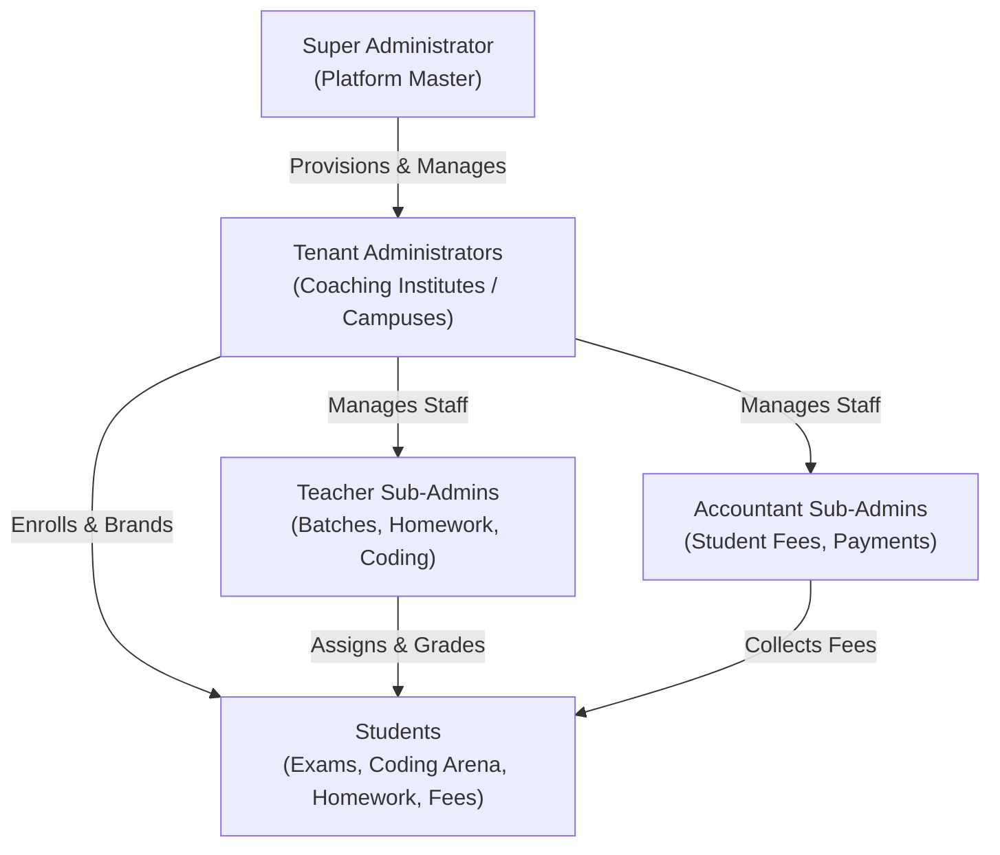
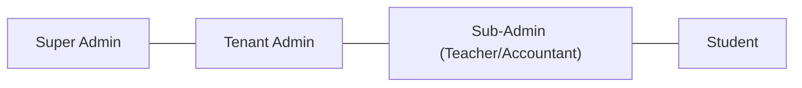
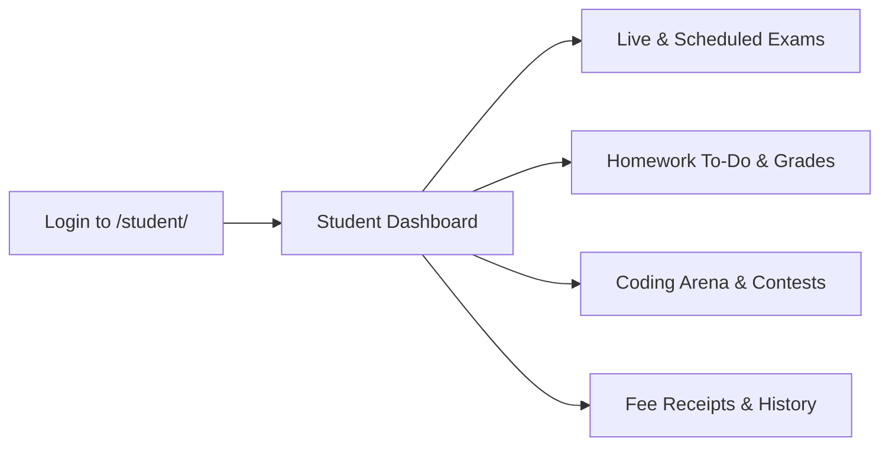
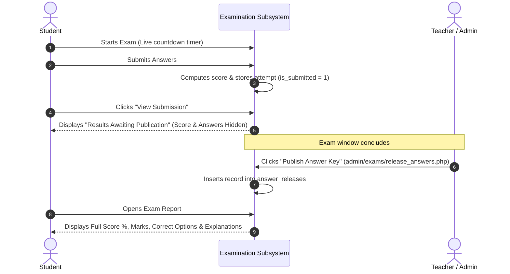
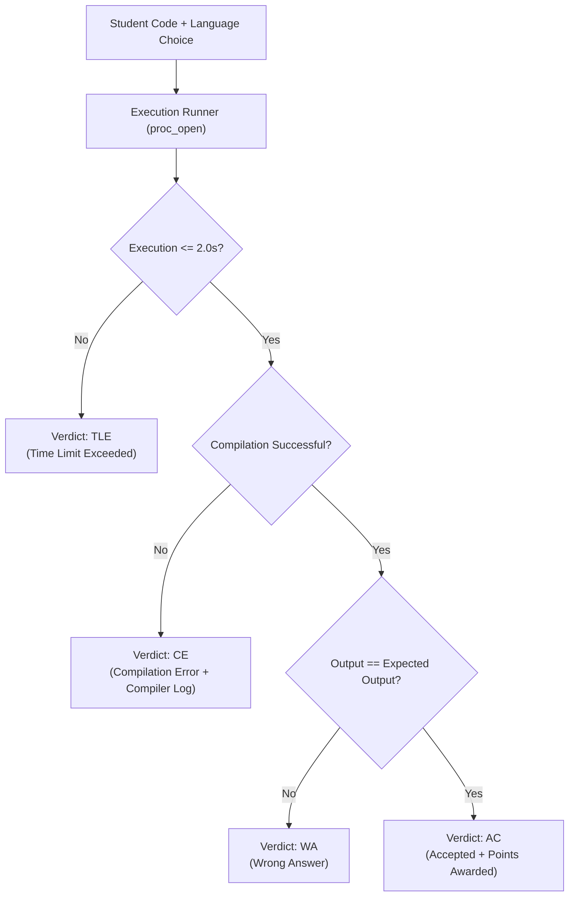
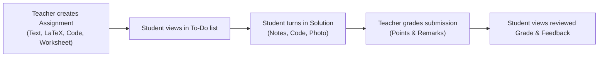

# EduERP: Complete End-to-End User Handbook

> **A Comprehensive Step-by-Step Guide for Novice Administrators, Teachers, Accountants, and Students**

---

## Table of Contents

1. [Introduction & System Architecture](#1-introduction--system-architecture)
2. [Role Hierarchy & Access Matrix](#2-role-hierarchy--access-matrix)
3. [Super Administrator Guide](#3-super-administrator-guide)
4. [Tenant Administrator (Institute Admin) Guide](#4-tenant-administrator-institute-admin-guide)
5. [Teacher (Sub-Admin) Guide](#5-teacher-sub-admin-guide)
6. [Accountant (Sub-Admin) Guide](#6-accountant-sub-admin-guide)
7. [Student Portal Guide](#7-student-portal-guide)
8. [Module Walkthroughs](#8-module-walkthroughs)
   - [8.1 Examination Engine & Score Gating](#81-examination-engine--score-gating)
   - [8.2 Online Coding Arena & Automated Judge](#82-online-coding-arena--automated-judge)
   - [8.3 Homework & Assignment Workflow](#83-homework--assignment-workflow)
   - [8.4 Student Fee Management & Ledgers](#84-student-fee-management--ledgers)
   - [8.5 Staff Payroll System](#85-staff-payroll-system)
   - [8.6 AI Question Bank Generation](#86-ai-question-bank-generation)
9. [Troubleshooting & Frequently Asked Questions](#9-troubleshooting--frequently-asked-questions)
10. [Security Best Practices](#10-security-best-practices)

---

## 1. Introduction & System Architecture

**EduERP** is an enterprise-grade, multi-tenant Educational Resource Planning and Online Assessment platform designed for coaching institutes, tuition centers, and schools.



### Key Gateway URLs

| Role | Web Gateway URL | Default Credentials Format |
| :--- | :--- | :--- |
| **Super Admin / Tenant Admin / Sub-Admin** | `http://<your-domain>/admin/` | Username & Password |
| **Student** | `http://<your-domain>/student/` | Student ID (`firstname.classboard###`) & Password |

---

## 2. Role Hierarchy & Access Matrix

The system provides 4 main user levels with strict role-based access control (RBAC):



| Feature / Capability | Super Admin | Tenant Admin | Teacher Sub-Admin | Accountant Sub-Admin | Student |
| :--- | :---: | :---: | :---: | :---: | :---: |
| **Create & Manage Institutes** | Yes | No | No | No | No |
| **Global Coding Platform Switch** | Yes | No | No | No | No |
| **Tenant Billing & Subscriptions** | Yes | No | No | No | No |
| **Academic Setup (Classes/Boards)** | Yes | Yes | View Only | View Only | View Only |
| **Student Enrollment & Password Reset**| Yes | Yes | Scoped | Scoped | No |
| **Create Exams & Question Banks** | Universal | Institute Only | Assigned | No | No |
| **Publish Answer Keys & Release Scores**| Yes | Yes | Assigned | No | No |
| **Online Coding Platform & Contests** | Full Oversight| Full Oversight| Create & Grade | No | Practice & Compete |
| **Homework Management & Grading** | Full Oversight| Full Oversight| Create & Grade | No | Solve & Turn In |
| **Record Student Fee Payments** | Yes | Yes | No | Yes | View Own Receipts |
| **View Institute Total Fee Collections**| Yes | Yes | No | No (Privacy Guard)| No |
| **Process Staff Payroll** | Yes | Yes | View Own Payslip| Yes (If permitted)| No |
| **Attempt Exams & View Results** | Preview | Preview | Preview | No | Yes |

---

## 3. Super Administrator Guide

As the **Super Administrator**, you are the master custodian of the platform.

### 3.1 Provisioning a New Tenant Administrator
1. Navigate to **Super Admin > Administrators** (`/admin/admins/index.php`).
2. Click the **"+ Add New Administrator"** button.
3. Fill in the modal details:
   - **Username:** e.g., `apex_academy`
   - **Institute Branding Name:** e.g., `Apex Coaching Institute` *(This name automatically appears on all student navbars, exams, and PDF certificates)*.
   - **Email Address:** For password resets and billing notifications.
   - **Temporary Password:** Click **"Generate"** for a secure random string.
   - **Force Password Change:** Checked by default so the tenant admin must set their own private password upon first login.
   - **Modular Permissions Checklist:** Check permitted modules or click preset buttons (*"All"*, *"Teaching"*, *"Questions Only"*).
4. Click **"Save Administrator"**.

### 3.2 Tenant Billing & Subscription Tracking
1. Open **Super Admin > Billing & Payments** (`/admin/admins/billing.php`).
2. Select the current **Billing Month & Year**.
3. Inspect each institute's:
   - **Enrolled Student Capacity:** Dynamically aggregated from the database.
   - **Payment Status:** `Paid` (Green), `Pending` (Yellow), or `Overdue` (Red with delay days).
4. To record a tenant subscription payment:
   - Click **"Record Payment"** in the table row.
   - Enter Amount, Payment Method (UPI, Bank Transfer, Cheque), and Transaction Reference.
   - Click **"Confirm Payment"** to generate an official digital invoice (`ADM-PAY-YYYYMM-XXXX`).
5. To nudge overdue accounts: Click **"Send Reminder"** or **"Batch Send Overdue Reminders"** to dispatch an automated HTML notice with Super Admin UPI details.

### 3.3 Global Online Coding Platform Switch
If server load is high or during maintenance, the Super Admin can toggle the Online Coding Platform on or off with 1 click:
1. Open **Coding & Contests > Dashboard** (`/admin/coding/index.php`).
2. Locate the banner **"Global Platform Status"**.
3. Toggle the switch between **Enabled** and **Disabled**. When disabled, students see an informative maintenance alert, and compiler processes are paused.

### 3.4 Support Authorization & Delegated Fix Mode
To maintain tenant autonomy, tenant private settings (Cloudinary API secrets, personal passwords) are locked by default.
1. If an admin requires assistance, have them click **"Grant Support Access"** in their **Account Settings**.
2. Alternatively, click **"Request Authorization Code via Email"** on their profile; an OTP code will be emailed to them.
3. Enter the 6-digit OTP code to unlock their Cloudinary CDN or credentials configuration for 15 minutes.

---

## 4. Tenant Administrator (Institute Admin) Guide

As an **Institute Administrator**, you oversee the academic and operational functions of your institution.

### 4.1 First Login & Account Setup
1. Log into `/admin/` using your temporary credentials.
2. The system redirects you to **Account Settings** (`/admin/settings.php?first_login=1`).
3. Enter your current password and choose a strong new password (minimum 8 characters with strength validation).
4. In the **Profile & Branding** tab, ensure your official **Institute Name** is typed accurately.

### 4.2 Setting Up the Academic Structure
Before adding students or exams, set up the curriculum:
1. Go to **Subjects & Topics** (`/admin/subjects/index.php`).
2. Confirm or add your **Classes** (e.g., Class 10, Class 11, Class 12, Dropper).
3. Confirm or add your **Boards** (e.g., CBSE, ICSE, WB State Board).
4. Add **Subjects** (e.g., Mathematics, Physics, Chemistry, Computer Science).
5. Add **Topics** nested under each subject for question bank categorization.

### 4.3 Onboarding Sub-Admins (Teachers & Accountants)
1. Navigate to **Students & Staff > Staff & Sub-Admins** (`/admin/sub_admins/index.php`).
2. Click **"+ Add Sub-Admin"**.
3. Choose the role:
   - **Teacher:** Granted access to Teaching Batches, Question Banks, Homework, and Coding Arena.
   - **Accountant:** Granted access to Student Fee Ledgers, Payment Recording, and Statements.
   - **Custom Staff:** Customize specific feature checkboxes.
4. Enter Full Name, Email, Phone, and Monthly Base Salary.
5. Save the profile. An automated welcome email containing their login credentials will be dispatched.

### 4.4 Creating Teaching Batches (Cohorts)
1. Navigate to **Batches & Cohorts** (`/admin/batches/index.php`).
2. Click **"+ Create New Batch"**.
3. Set Batch Name (e.g., `Class 12 JEE Elite 2026`), select Class, Board, Subject, and assign a Teacher.
4. Input the schedule (e.g., `Mon, Wed, Fri • 5:00 PM - 7:00 PM`).
5. Click **"Save Batch"**.
6. Click the **"Students"** button on the batch card to search and enroll candidates into the cohort.

### 4.5 Enrolling Students
1. Navigate to **Students > All Students** (`/admin/students/index.php`).
2. Click **"+ Add New Student"**.
3. Enter Full Name, Email, Phone, Class, and Board.
4. The system automatically creates a canonical student ID (`firstname.classboard###`).
5. Click **"Send Credentials"** to email the student their portal password.

---

## 5. Teacher (Sub-Admin) Guide

As a **Teacher**, your portal is centered on classroom instruction, assignments, assessments, and coding practice.

### 5.1 Homework & Assignments Management
1. Navigate to **Homework Assignments** (`/admin/homework/index.php`).
2. Click **"+ Create Assignment"** (`/admin/homework/create.php`).
3. Fill out the assignment:
   - **Targeting:** Choose to assign to an entire **Class** or restrict to a specific **Batch**.
   - **Problem Description:** Use the rich Summernote editor.
   - **LaTeX Mathematics:** Click math symbol buttons ($\frac{a}{b}, \sqrt{x}, \int, \sum$) to insert LaTeX equations.
   - **Problem Worksheet / Diagram:** Upload a PNG, JPG, or WebP worksheet image.
   - **Programming Problem Toggle:** If enabled, choose language (Python, Java, C++, C) and paste starter code template.
   - **Dates:** Set Assigned Date/Time and Due Date/Time using Flatpickr.
   - **Points:** Enter total marks (e.g., 20).
4. Click **"Publish Assignment"**.

### 5.2 Evaluating & Grading Submissions
1. In the Homework dashboard, click **"Submissions"** on any assignment.
2. Inspect the student list with turn-in badges: `Submitted`, `Late`, or `Pending`.
3. Click **"Review Solution"**:
   - Inspect written answer text.
   - Review submitted programming code with syntax highlighting.
   - Click student handwritten notebook photos to zoom in high-resolution lightbox.
   - Enter **Awarded Points** (e.g., 18.5 / 20) and **Teacher Remarks / Feedback**.
4. Click **"Save Evaluation"**. The student is immediately notified in their portal.

### 5.3 Hosting Online Coding Contests
1. Go to **Coding & Contests > Competitions** (`/admin/coding/competition_create.php`).
2. Title the contest (e.g., `Weekend Algorithm Sprint #1`).
3. Set Start Time, Duration (e.g., 90 mins), and target Batch.
4. Select 2 to 5 problems from the problem repository and assign points per problem.
5. Click **"Schedule Competition"**.
6. During or after the contest, open **"Live Standings"** (`/admin/coding/leaderboard.php`) to view real-time student rankings.

---

## 6. Accountant (Sub-Admin) Guide

As an **Accountant**, you manage monthly student fees, payment receipts, and collection reminders.

### 6.1 Recording a Student Fee Payment
1. Navigate to **Fees & Payments** (`/admin/fees/index.php`).
2. Find the student using the search bar.
3. In the 12-Month Matrix (Jan–Dec), click any unpaid (Red) month pill or click **"Quick Collect"**.
4. Enter:
   - **Amount Paid** (pre-filled with class rate).
   - **Payment Method:** UPI, Cash, Bank Transfer, Net Banking.
   - **Transaction / UTR Reference:** (e.g., `UPI-982348712398`).
   - **Send Email Receipt:** Checked by default.
5. Click **"Record Payment & Generate Receipt"**.
6. The month pill turns **Green (Paid)** and an official electronic receipt (`REC-YYYYMM-XXXX-XXXX`) is issued.

### 6.2 Printing Student Ledgers
1. Click the **"Ledger"** button beside any student.
2. View the full 12-month statement breakdown.
3. Click **"Print Statement"** for a clean, letterhead-branded physical copy for parents.

> [!NOTE]
> **Financial Privacy Guard:** For security and business confidentiality, aggregate monthly collection totals across the entire institute are restricted to Institute Admins and Super Admins. Accountant profiles can view and manage individual student payments but cannot view total institute revenue.

---

## 7. Student Portal Guide

As a **Student**, your portal provides access to live examinations, assignments, coding challenges, and financial receipts.



### 7.1 Taking an Online Exam
1. Log in at `http://<domain>/student/`.
2. On the **Exam Dashboard**, locate the **Live Exams** tab.
3. Click **"Start Exam"**. *(Confirm the prompt; the timer begins immediately)*.
4. Inside the exam room:
   - Sticky top bar shows the **Countdown Timer** and your institute branding.
   - Click options (A, B, C, D) to select answers.
   - Use the Question Palette to jump between questions.
   - When finished, click **"Submit Exam"**.
   - If the timer hits `00:00`, the exam **auto-submits** automatically to protect your answers.

### 7.2 Results & Score Gating
* **Immediately after submission:** Your exam status changes to `Completed`.
* When clicking **"View Submission (Result Awaited)"**:
  * You will see the **"Results Awaiting Publication"** banner.
  * Your answers are safely logged, but your score, percentage, and correct answers are hidden.
* **Once the teacher publishes the answer key:**
  * The button changes to **"View Report & Key"**.
  * Your full score card, percentage, correct answer breakdown, and solution explanations become visible.

### 7.3 Solving & Submitting Homework
1. Click **"Homework"** in the top navbar (`/student/homework.php`).
2. Switch between **"To-Do / Due"** and **"Completed"** tabs.
3. Click **"Solve & Submit"** on any assignment:
   - Read the typeset problem statement and formulas.
   - Inspect attached problem diagrams.
   - If it's a programming assignment, click **"Copy Code"** to copy starter templates.
   - Submit your solution using any combination of:
     1. **Written Solution:** Type your answers or mathematical working.
     2. **Code Editor:** Paste programming code.
     3. **Notebook Photo Upload:** Attach photos of your handwritten notebook pages.
4. Click **"Turn In Homework"**. Once reviewed, your awarded score and teacher feedback remarks appear right on the card.

### 7.4 Using the Online Coding Arena
1. Click **"Coding Arena"** in the navbar (`/student/coding/index.php`).
2. Choose a practice problem (e.g., *Palindrome Number*, *Reverse a String*):
   - **Left Pane:** Problem statement, constraints, sample test cases.
   - **Right Pane:** Ace code editor with auto-save to browser storage.
   - Select your language: **Python 3**, **Java 17**, **C++17**, or **C11**.
   - Select your theme: Dracula, Monokai, Night, or Light.
3. Click **"Run Code"** to test against sample testcases or your own custom input.
4. Click **"Submit Solution"** for official grading against all hidden test cases. Receive real-time verdicts:
   - `AC` (Accepted - 100% Correct)
   - `WA` (Wrong Answer)
   - `TLE` (Time Limit Exceeded)
   - `CE` (Compilation Error - inspect compiler log)

---

## 8. Module Walkthroughs

### 8.1 Examination Engine & Score Gating Workflow



---

### 8.2 Online Coding Arena & Sandboxed Execution

The system executes student code inside an isolated process runner:



---

### 8.3 Homework & Assignment Workflow



---

### 8.4 Student Fee Management & Ledgers

* **12-Month Grid:** Each month is displayed as an interactive pill.
* **Colors:**
  * <span style="color:#10b981;font-weight:bold;">Green:</span> Paid (shows receipt number and date).
  * <span style="color:#ef4444;font-weight:bold;">Red:</span> Unpaid / Due.
* **Automated Reminders:**
  * Runs automatically on the **15th** (mid-month nudge) and **last day of the month** (end-of-month alert).
  * Can be triggered manually via CLI or secure web cron:
    ```bash
    php cron/fee_reminders.php --notify-defaulters
    ```

---

### 8.5 Staff Payroll System

1. Each sub-admin profile has an assigned monthly **Base Salary**.
2. At the end of the month, Institute Admins or Accountants disburse salaries:
   $$\text{Net Pay} = \text{Base Salary} + \text{Bonus} - \text{Deductions}$$
3. Generates digital voucher with unique receipt format: `PAY-YYYYMM-XXXX-XXXX`.
4. Optionally delivers an itemized HTML payslip voucher to the staff member's email address.

---

### 8.6 AI Question Bank Generation

Powered by OpenRouter LLM integration:
1. Open **Question Bank > Single Question > Generate with AI**.
2. Select Class, Board, Subject, Topic, and Difficulty (*Easy, Medium, Hard, Olympiad*).
3. Select AI Model (e.g., *Gemini 2.0 Flash, DeepSeek V3, Claude 3.5 Sonnet, GPT-4o Mini*).
4. Click **"Generate Question"**.
5. Inspect formatted preview (rendered math formulas, options, correct choice badge, explanation).
6. Click **"Apply to Form"** to transfer content directly into the Summernote editor and form fields.

---

## 9. Troubleshooting & Frequently Asked Questions

### Q1: Why can't students see their scores immediately after submitting an exam?
> **Answer:** This is a security and anti-cheat feature. Scores and correct answers are held until the administration officially releases the answer key via **Publish Answer Key**. This prevents early finishers from leaking answers to classmates who have not yet submitted.

### Q2: Why is the Online Coding Arena missing from the student navbar?
> **Answer:** The Super Administrator has toggled the coding platform off globally, or compilation compilers are undergoing maintenance. Contact your Super Administrator to verify the switch in `/admin/coding/index.php`.

### Q3: A student forgot their password. How do I reset it?
> **Answer:** Navigate to **Students > All Students**, locate the student, and click **"Email Credentials"** or click **"Edit"** to set a new password manually.

### Q4: An accountant cannot see the institute's total monthly fee collection. Is this a bug?
> **Answer:** No. This is intentional by design. The platform enforces a strict **Financial Privacy Guard** where only Institute Admins and Super Admins can view aggregate revenue figures. Accountants are permitted to collect individual fees and issue receipts without exposing overall business revenue.

### Q5: What image formats are supported for question diagrams and homework?
> **Answer:** JPG, PNG, and WebP are natively supported. WebP is recommended as the system automatically compresses images to under 50KB for fast page loading.

---

## 10. Security Best Practices

1. **Two-Factor Authentication (TOTP):**
   - All administrators and staff should enable Google Authenticator 2FA via **Account Settings > 2FA & Security**.
2. **Account Lockouts:**
   - 5 consecutive incorrect login attempts trigger a **15-minute security lockout** by IP address and username to block brute-force attacks.
3. **Session Inactivity Timeout:**
   - Administrative and student sessions automatically invalidate after **10 minutes of inactivity** to prevent unauthorized access on shared computers.
4. **Environment Variables:**
   - Keep `.env` out of version control. Never share database passwords or SMTP secrets.
5. **Regular Database Backups:**
   - Take regular database backups via Docker:
     ```bash
     docker exec shreyansir_db mysqldump -u root -prootpassword shreyansir_db > backups/backup_$(date +%Y%m%d).sql
     ```
